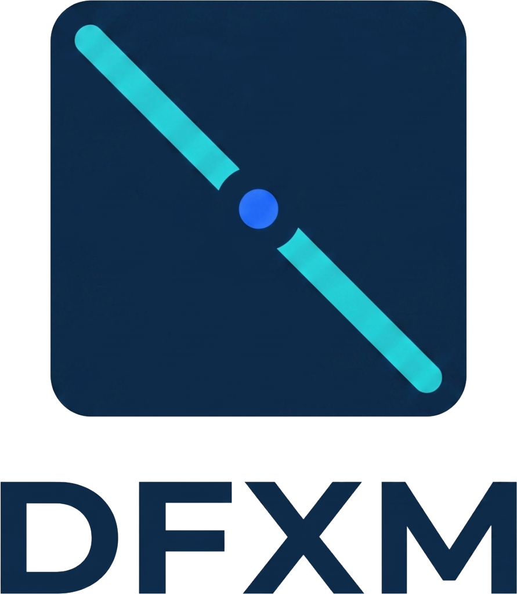
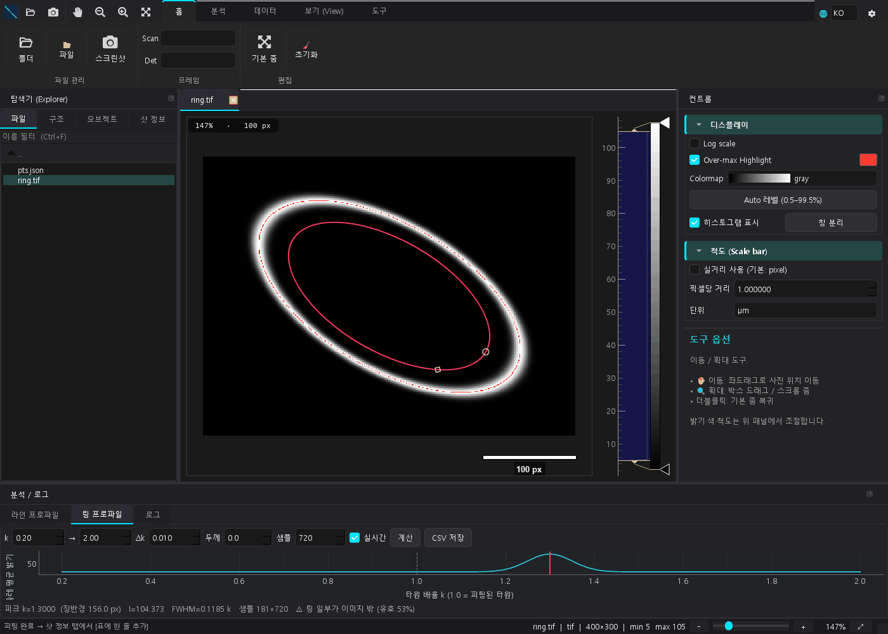

<picture>
  <source media="(prefers-color-scheme: dark)" srcset="src/qoradfxm/gui/assets/logo_full_on_dark.png">
  
</picture>

# QoraDFXM

[](https://github.com/NaNIsaac/QoraDFXM/actions/workflows/ci.yml) [](LICENSE)

**Dark-Field X-ray Microscopy detector-image analysis: a pure Python engine with
two front-ends, a headless CLI and a PySide6 desktop app.**

For DFXM beamline users who need to measure ring-shaped features in detector
images shot by shot. QoraDFXM loads frames from HDF5 or image files, applies dark
subtraction, flat-field division and display transforms, fits an ellipse to
points picked on a ring, and collects centre, axes, tilt and fit error for every
shot in one table (CSV). It can also sweep the fitted ellipse outward and report
the mean brightness along it. The same steps run from the command line for batch
work or in a desktop app for picking points by hand.



*Synthetic ring image (400×300, ring at 1.3× the fitted ellipse). Eight points on
the inner ellipse are fitted; the ring profile tab peaks at k = 1.3.*

```bash
qoradfxm fit shot.h5 --dataset /run/scan00001/det/camera/data     --op sub_bg:/dark --op log --points pts.json --out results.csv
```

`pts.json` is a list of `[x, y]` pixel coordinates on the ring (at least 5).
`python examples/synthetic_ring.py` writes synthetic `ring.tif`, `pts.json`,
`shot.h5` and `shot2.h5` to `examples/data/` to try these commands on; no
measured data ships with the repo.
Layer layout: [docs/ARCHITECTURE.md](https://github.com/NaNIsaac/QoraDFXM/blob/main/docs/ARCHITECTURE.md).

## Install

Requires Python 3.14. Not on PyPI yet; install from GitHub or a clone:

```bash
pip install "qoradfxm[gui] @ git+https://github.com/NaNIsaac/QoraDFXM"   # desktop app
pip install "git+https://github.com/NaNIsaac/QoraDFXM"                  # headless: engine + CLI, no Qt
```

From a clone with [uv](https://docs.astral.sh/uv/):

```bash
uv sync                     # engine + CLI + GUI (the dev group pulls qoradfxm[gui])
uv sync --no-dev            # engine + CLI only, no Qt
```

`cupy` (GPU) is an opt-in extra: `uv sync --extra cuda`.

## CLI

```bash
qoradfxm info shot.h5 [--tree]                    # frames, shapes, HDF5 structure
qoradfxm convert dat/ -o tif/                     # export detector frames to TIFF
qoradfxm fit shot.h5 \
    --dataset /run/scan00001/det/camera/data \
    --op sub_bg:/dark --op divide:flat.tif --op gamma:0.5 --op log \
    --points pts.json --out results.csv
qoradfxm ring shot.h5 --points pts.json \
    --k 0.5:2.0:0.005 --width 3 --out ring.csv --map ring_map.tif
qoradfxm gui shot.h5                              # launch the desktop app
```

`ring` sweeps the fitted ellipse's scale `k` and reports the mean brightness
along its contour (intensity per unit length), with `peak k` / FWHM printed and
the curve written to CSV. The ellipse comes from `--points` or from a Master CSV
(`--from-csv results.csv --shot-id …`). It measures on **linear** intensity —
log/gamma ops are stripped unless you pass `--keep-log`.

Ops apply in the order given:

| op | meaning |
|---|---|
| `sub_bg:SRC` / `divide:SRC` | dark subtract / flat-field divide |
| `log`, `pure_log`, `sqrt`, `gamma:0.5`, `normalize` | intensity transforms |
| `scale:1.5`, `scale:2x0.5` | resize; `sxXsy` changes the aspect ratio |
| `rotate:30` | rotate degrees, + = counter-clockwise (canvas expands) |
| `flip:h` / `flip:v` / `flip:both` | mirror |

`SRC` starting with `/` (and not an image suffix) is a dataset inside the same
HDF5; anything else is a file path. Geometric ops change the image shape — put
them after `sub_bg`/`divide` (a reference of another shape is an error, not a
skip) and before a fit, since points picked earlier no longer line up.
Without `--points`, `fit` only reports the processed image stats.

Example on the same synthetic ring image, with eight points on the inner
ellipse (centre 200, 150; semi-axes 120, 60; 30°):

```console
$ python examples/synthetic_ring.py && cd examples/data
$ qoradfxm fit ring.tif --points pts.json --out results.csv
wrote results.csv (1 row)
$ cat results.csv
shot_id,status,center_x,center_y,major_axis,minor_axis,angle_deg,fit_error,points_json,bg_applied,log_scale
ring,OK,200.0,150.00000000000003,240.00157168475877,120.00078610129981,29.998661369599404,0.0024524655399003918,"[[303.92, 210.0], [252.27, 229.17], [170.0, 201.96], [105.3, 144.32], [96.08, 90.0], [147.73, 70.83], [230.0, 98.04], [294.7, 155.68]]",False,False
$ qoradfxm ring ring.tif --points pts.json --k 0.5:2.0:0.005 --width 3 --out ring.csv
shot_id  : ring
ellipse  : a=120.00 b=60.00 px, angle=30.00°
k range  : 0.5 … 2  (301 steps)
peak     : k=1.3000 (a·k=156.00 px)  I=100.833  FWHM=0.1230 k
note     : some rings leave the image (min valid fraction 0.56)
wrote ring.csv (301 rows)
```

Columns of `results.csv`: everything is in pixels of the processed image (after any geometric
`--op`), with x to the right and y down. `major_axis` and `minor_axis` are the full **diameters**
(240 and 120 above for semi-axes 120 and 60). `angle_deg` is the angle of the major axis from +x,
measured in those image coordinates. `fit_error` is the RMS Sampson distance of the picked points
from the fitted ellipse.

The desktop app also has its own entry point, `qoradfxm-gui [files...]`.
Module form (no install step): `python -m qoradfxm.cli ...`, `python -m qoradfxm.gui`.

## Python

```python
from qoradfxm.core import QoraDFXMDataset

ds = (QoraDFXMDataset.from_h5("shot.h5", "/run/scan00001/det/camera/data")
        .sub_bg(dataset_path="/dark")
        .apply_log()
        .fit_ellipse(points))
row = ds.to_record()   # one Master-table row
```

## Dev

```bash
uv run task gui     # launch the app
uv run task cli     # qoradfxm CLI
uv run task lint    # ruff check + format --check
uv run pytest       # GUI tests run on Qt's offscreen platform
```

## Citation

See [CITATION.cff](CITATION.cff).

## License

MIT, see [LICENSE](LICENSE).
